# COMP 3613 Software Engineering II
## Assignment 2 — Student Awards Application Test Report

**Student name:** Edan Ali  
**Student ID:** 816039649  
**Project:** Student Awards  
**Repository:** [al5428/comp3613a1 — assignment2 branch](https://github.com/al5428/comp3613a1/tree/assignment2)  
**Report date:** 7 November 2026

<!-- pdf-page-break -->

## Contents

1. [A. Project overview and workflows](#a-project-overview-and-workflows)
2. [B. Design artifacts](#b-design-artifacts)
3. [C. Test plans](#c-test-plans)
4. [D. Test implementation](#d-test-implementation)
5. [E. Test reports and results](#e-test-reports-and-results)
6. [F. Conclusion and limitations](#f-conclusion-and-limitations)
7. [Appendix A. Test artifact locations](#appendix-a-test-artifact-locations)

<!-- pdf-page-break -->

## A. Project overview and workflows

### A.1 Project description

The Student Awards application is a web-based volunteer recognition system. It has two primary roles:

- **Students** submit volunteer activities with the activity name, hours worked, activity date, description, and supporting evidence. A new submission is pending review. Students can view their approved-hour total, submission history, milestone progress, and award status.
- **Administrators** review submitted activity details and evidence, then approve or reject volunteer-hour submissions. They also review award redemption requests.

Only approved volunteer hours contribute to a student's progress. The application tracks three thresholds: **Plaque (25 hours)**, **Medal (50 hours)**, and **Trophy (100 hours)**. When eligible, a student can request the corresponding award. Redemption requests are reviewed by an administrator; the application prevents a student from requesting the same award more than once.

### A.2 Main workflows

The project’s three main workflows are:

1. Verify Volunteer Hours
2. Track Progress and Unlock Milestones
3. Redeem an Award

<!-- pdf-page-break -->

## B. Design artifacts

### B.1 Use Case Diagram

The supplied diagram shows the Student and Administrator actors, the three main workflows, and the supporting evidence and milestone-detail use cases.

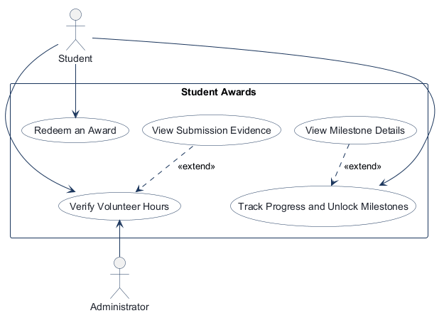

**Figure 1.** Student Awards use case diagram supplied for Assignment 2.

<!-- pdf-page-break -->

### B.2 Entity Relationship Diagram (ERD)

The supplied ERD shows Student, Administrator, Volunteer Submission, Milestone, Student Milestone, Award, and Redeemed Award entities and their relationships.

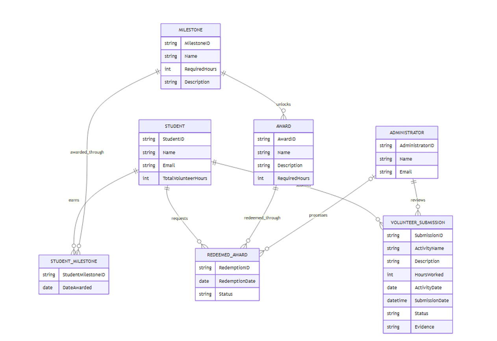

**Figure 2.** Student Awards ERD supplied for Assignment 2.

<!-- pdf-page-break -->

### B.3 Application Wireframes

The wireframe image covers student volunteer-hour submission, administrator review, progress and milestone details, and award redemption.


**Figure 3.** Student Awards application wireframes supplied for Assignment 2.

<!-- pdf-page-break -->

## C. Test plans

### C.1 Unit Test Plan

#### 1. Objective

Verify that individual methods in `VolunteerService` handle validation, approved-hour calculations, and award redemption rules correctly without using a real database.

#### 2. Testing Approach

Each test targets one method. Repository and database dependencies will be replaced with mocks so tests are independent and repeatable.

#### 3. Unit Test Cases

The table follows Tutorial 4's **Unit Test / Module Tested / Expected Output** format.

| Unit Test | Module Tested | Expected Output |
|---|---|---|
| **UT01** `test_empty_activity_name` | `create_submission()` with an empty activity name | Raises `ValueError` |
| **UT02** `test_zero_volunteer_hours` | `create_submission()` with `hours_worked=0` | Raises `ValueError` |
| **UT03** `test_approved_hours` | `get_total_approved_hours()` with mocked approved submissions of 5 and 10 hours | Returns `15` |
| **UT04** `test_invalid_review_decision` | `review_submission()` with `decision="pending"` | Raises `ValueError` |
| **UT05** `test_ineligible_redemption` | `redeem_award()` with 20 approved hours and a 25-hour award | Raises `ValueError` |
| **UT06** `test_duplicate_redemption` | `redeem_award()` when a previous request exists | Raises `ValueError` |
| **UT07** `test_award_eligibility` | `list_awards_for_student()` with 25 hours and a 50-hour award | `eligible=False` and `hours_remaining=25` |
| **UT08** `test_invalid_redemption_review` | `review_redemption()` with `decision="cancelled"` | Raises `ValueError` |

#### 4. Entry Criteria

- The Student Awards application source code is available.
- pytest and project dependencies are installed.
- Mocks can be configured for service dependencies.

### C.2 Integration Test Plan

#### 1. Objective

Verify that the Student Awards application's services, repositories, models, and database work together to support its main workflows.

#### 2. Testing Approach

The existing tests create an isolated in-memory SQLite database. They exercise real application components without changing the deployed PostgreSQL database.

#### 3. Integration Test Cases

The table follows Tutorial 4's **Test / Dependencies / Description** format.

| Test | Dependencies | Description |
|---|---|---|
| **IT01** `test_submit_and_review_flow` | Submission service, review service, repositories, database | A submission starts as pending and is approved by the correct administrator. |
| **IT02** `test_student_service_resolves_user_to_different_student_id` | Student lookup, submission service, database | A submission uses the correct student ID even when it differs from the user ID. |
| **IT03** `test_milestone_unlock_and_award_redemption` | Submission review, hour synchronization, milestones, redemptions | Approved hours unlock a milestone; redemption can be reviewed; a duplicate request is blocked. |
| **IT04** `test_demo_seed_data_is_consistent_and_rerunnable` | Seed function, models, repositories, database | Demo records remain consistent when seeding is repeated. |
| **IT05** `test_legacy_bob_account_is_migrated_without_losing_student_history` | Seed function, user and student models, database | Legacy student identity and records are preserved during migration. |
| **IT06** `test_seed_adds_description_column_to_legacy_submission_table` | Schema update helper, database | A missing `description` column is added to a legacy table. |
| **IT07** `test_seed_adds_and_backfills_activity_date_column` | Schema update helper, database | A missing `activity_date` column is added and existing dates are backfilled. |

#### 4. Entry Criteria

- Application models, services, and repositories are available.
- pytest and database dependencies are installed.
- The test database can be initialized.

### C.3 User Acceptance Test Plan

#### 1. Objective

Confirm that students and administrators can complete the main tasks shown in the Student Awards use cases and wireframes.

#### 2. Test Environment

| Item | Details |
|---|---|
| Application | Student Awards web application |
| Platform | Web browser |
| Environment | Deployed application |
| Test participants | Student-role and administrator-role testers |
| Test data | Demo accounts, submissions, milestones, and awards |

#### 3. Acceptance Test Cases

This table follows Tutorial 4's **Test Case / Pre-conditions / Test Steps / Test Criteria / Success** format.

| Test Case | Pre-conditions | Test Steps | Test Criteria | Success |
|---|---|---|---|:---:|
| **UAT01** Submit volunteer hours | Student is logged in. | Open Volunteer Hours; enter activity details; submit. | Submission appears as **Pending**. | ☑ |
| **UAT02** Approve submission | Administrator is logged in; a pending submission exists. | Open submission; review details; select Approve. | Status changes to **Approved**. | ☑ |
| **UAT03** Reject submission | Administrator is logged in; another pending submission exists. | Open submission; select Reject. | Status changes to **Rejected**. | ☑ |
| **UAT04** View progress | Student is logged in; submissions exist. | Open Dashboard; inspect volunteer-hour total. | Only approved hours count toward progress. | ☑ |
| **UAT05** Unlock milestone | Student has at least 25 approved hours. | Open Dashboard; inspect milestones. | **Plaque** is unlocked. | ☑ |
| **UAT06** Redeem award | Student is eligible and has not requested the award. | Open Awards; select award; request redemption. | Redemption is shown as **Pending**. | ☑ |
| **UAT07** Block duplicate redemption | Student has already requested the award. | Open Awards; inspect the previously requested award. | No second redemption option is available through the student interface. | ☑ |
| **UAT08** Review redemption | Administrator is logged in; a pending redemption exists. | Open request; approve or reject it. | Redemption displays the selected status. | ☑ |

#### 4. Acceptance Criteria

A test passes when the tester can perform the stated steps and observe the expected result in the application interface without an unexpected error.

#### 5. UAT Results Record

The following results were recorded after executing all eight User Acceptance Tests on the deployed Student Awards application.

| Test ID | Actual Result | Pass / Fail | Comments |
|---|---|:---:|---|
| UAT01 | 6-hour Community Cleanup submission displayed with Pending status. | ☑ Pass | The updated UAT01 screenshot shows 6 hours and Pending status. |
| UAT02 | Administrator approved the 6-hour Community Cleanup submission, and its status changed to Approved. | ☑ Pass | The screenshot matches UAT01's activity name and 6-hour value; no submission ID is visible to confirm it is the same record. |
| UAT03 | Administrator rejected Beach Cleanup, and its status changed to Rejected. | ☑ Pass | Successfully rejected the 3-hour submission. |
| UAT04 | Dashboard displayed 11 approved hours, excluding the rejected 3-hour submission. | ☑ Pass | This is the progress snapshot before the additional approved hours recorded by UAT05. |
| UAT05 | After additional approved hours, the student reached 25 approved hours and the Plaque Milestone displayed Unlocked. | ☑ Pass | The later dashboard shows 25 approved hours and the Plaque Milestone unlocked. |
| UAT06 | Plaque Award redemption request displayed Pending status. | ☑ Pass | Student successfully requested the Plaque Award after reaching 25 approved hours. |
| UAT07 | Plaque Award displayed Pending status with no option to request redemption again. | ☑ Pass | Duplicate redemption prevented through the student interface. |
| UAT08 | Administrator approved Bob's Plaque Award redemption, and its status changed to Approved. | ☑ Pass | Award redemption successfully reviewed and approved. |

#### 6. UAT Summary

All 8 User Acceptance Tests passed successfully. The Student Awards application supported volunteer-hour submission, administrator approval and rejection, student progress tracking, milestone unlocking, award redemption, and prevention of duplicate redemption through the student interface.

**Overall UAT Result: 8/8 Passed (100%)**

<!-- pdf-page-break -->

## D. Test implementation

### D.1 Unit test implementation

The isolated unit tests are in [`tests/test_volunteer_service_unit.py`](../../tests/test_volunteer_service_unit.py). They test existing `VolunteerService` methods using `pytest` and `unittest.mock.Mock`; the fixture supplies a mock database object and replaces repository dependencies with mocks. The tests do not create SQLModel sessions or connect to a database.

The eight tests cover:

1. `test_empty_activity_name` — rejects a blank activity name and verifies the submission repository is not called.
2. `test_zero_volunteer_hours` — rejects zero hours and verifies the submission repository is not called.
3. `test_approved_hours` — totals mocked approved submissions of 5 and 10 hours as 15.
4. `test_invalid_review_decision` — rejects `pending` as a review decision and verifies no update call is made.
5. `test_ineligible_redemption` — rejects redemption at 20 hours for a 25-hour award and verifies no redemption lookup or creation occurs.
6. `test_duplicate_redemption` — rejects a second request for an already-requested award and verifies no new redemption is created.
7. `test_award_eligibility` — checks that 25 hours is insufficient for a 50-hour award and that 25 hours remain.
8. `test_invalid_redemption_review` — rejects `cancelled` as a decision and verifies no redemption update is made.

### D.2 Integration test implementation

The integration tests are in [`tests/test_student_awards_flow.py`](../../tests/test_student_awards_flow.py). They use real application models, services, repositories, and helper functions with an in-memory SQLite engine. This covers database-backed interactions while avoiding the deployed PostgreSQL database.

The seven integration tests cover submission and review, user-to-student ID resolution, milestone unlock and award redemption, repeatable demo seeding, legacy account migration, adding the legacy `description` column, and adding/backfilling the `activity_date` column. The seed test also checks record counts and consistency across students, submissions, milestones, awards, and redemptions.

### D.3 Postman API test implementation

The exported Postman collection is [`COMP3613 Assignment 2 - Student Awards API Tests.postman_collection.json`](../../COMP3613%20Assignment%202%20-%20Student%20Awards%20API%20Tests.postman_collection.json). It contains ten **GET-only** requests. Its assertions cover:

- Health-check status and JSON health value.
- Login, home, and registration page status/content type.
- Denial of unauthenticated access to student and administrator pages.
- Rejection of a milestone path parameter that is not an integer.

The collection does not contain POST, PUT, PATCH, or DELETE requests; its run therefore does not verify state-changing API operations. The supplied Postman screenshots show a single iteration with **10 requests, 21 assertions passed, 0 failed, and 0 errors** against the deployed service.

### D.4 Pytest CLI commands

Run these commands from the repository root in Windows PowerShell. They target the two test files represented in the supplied pytest results:

```powershell
.\.venv\Scripts\python.exe -m pytest tests\test_volunteer_service_unit.py -q
.\.venv\Scripts\python.exe -m pytest tests\test_student_awards_flow.py -q
```

To run both suites together:

```powershell
.\.venv\Scripts\python.exe -m pytest tests\test_volunteer_service_unit.py tests\test_student_awards_flow.py -q
```

## E. Test reports and results

<!-- pdf-page-break -->

### E.1 Unit test result

The supplied pytest result screenshot shows **8 tests passed** for `tests/test_volunteer_service_unit.py`.

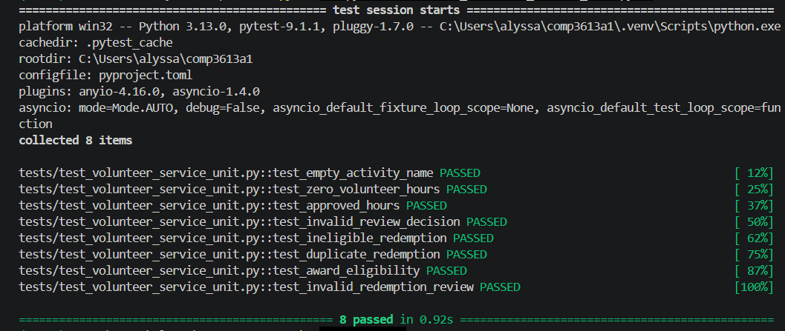

**Figure 4.** Unit test run showing all 8 planned VolunteerService unit tests passed.

<!-- pdf-page-break -->

### E.2 Integration test result

The supplied pytest result screenshot shows **7 tests passed** for `tests/test_student_awards_flow.py`. It also shows one SQLAlchemy/SQLite deprecation warning; the warning did not cause a test failure.

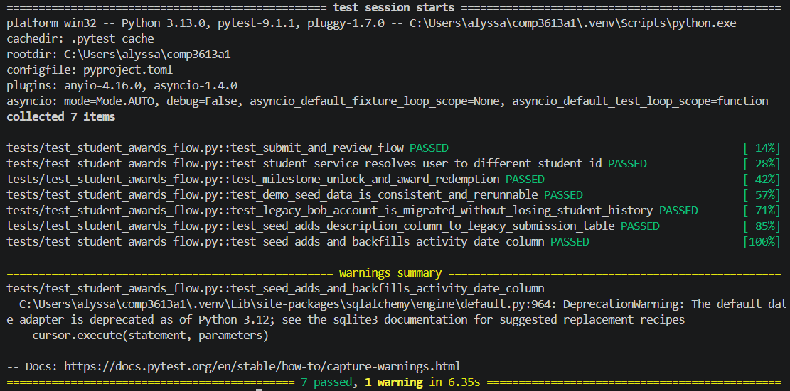

**Figure 5.** Integration test run showing 7 tests passed and one deprecation warning.

<!-- pdf-page-break -->

### E.3 Postman collection run

The first screenshot shows the Postman run summary and the first requests; the second continues the request list. Together they show the completed ten-request collection and the **21/21 passing assertions**.

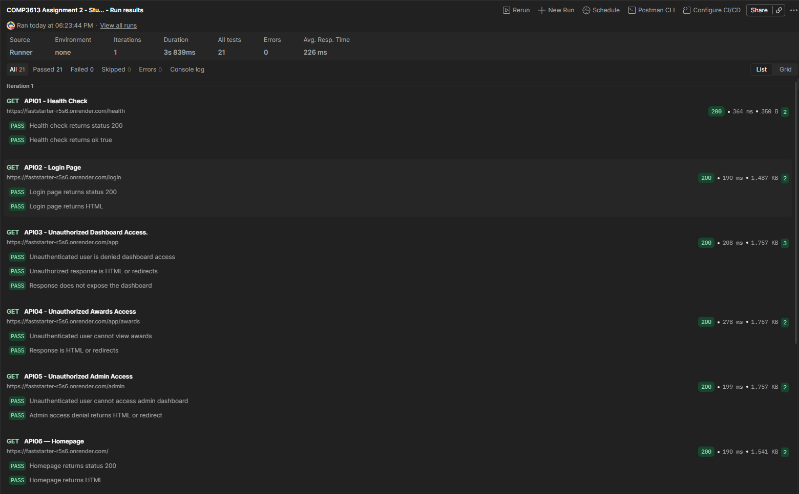

**Figure 6.** Postman run summary and API01–API06 results.

<!-- pdf-page-break -->

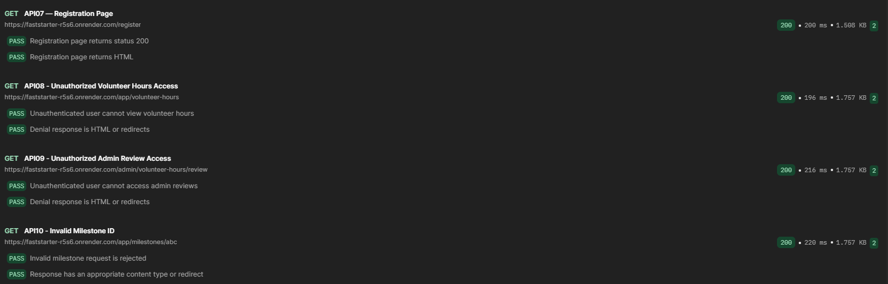

**Figure 7.** Postman API07–API10 results, including registration, protected-route, and invalid milestone checks.

<!-- pdf-page-break -->

### E.4 User Acceptance Test evidence

The UAT plan records all eight acceptance tests as passed. Each supplied screenshot below is included as evidence for its corresponding test case.

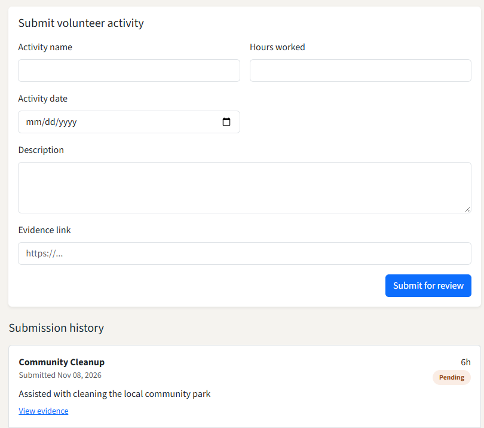

**Figure 8.** UAT01 — Updated screenshot showing the 6-hour Community Cleanup submission as pending.

<!-- pdf-page-break -->

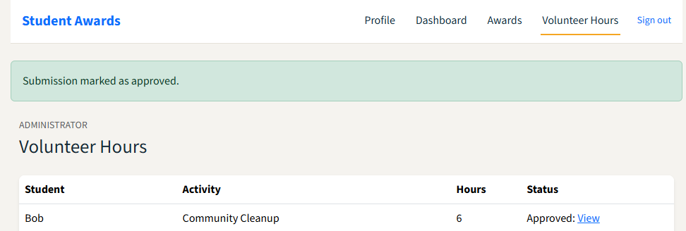

**Figure 9.** UAT02 — Administrator approval of the 6-hour Community Cleanup activity, matching the activity name and hours shown as pending in UAT01.

<!-- pdf-page-break -->

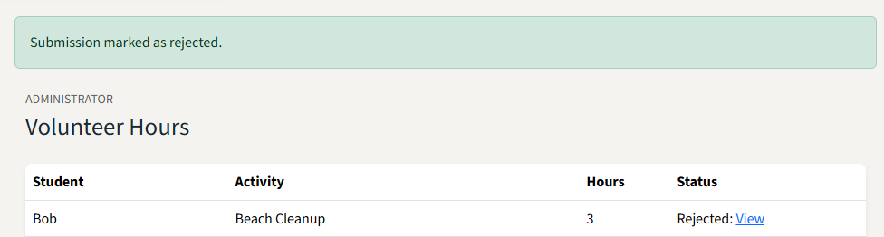

**Figure 10.** UAT03 — Administrator rejection confirmation and submission list.

<!-- pdf-page-break -->

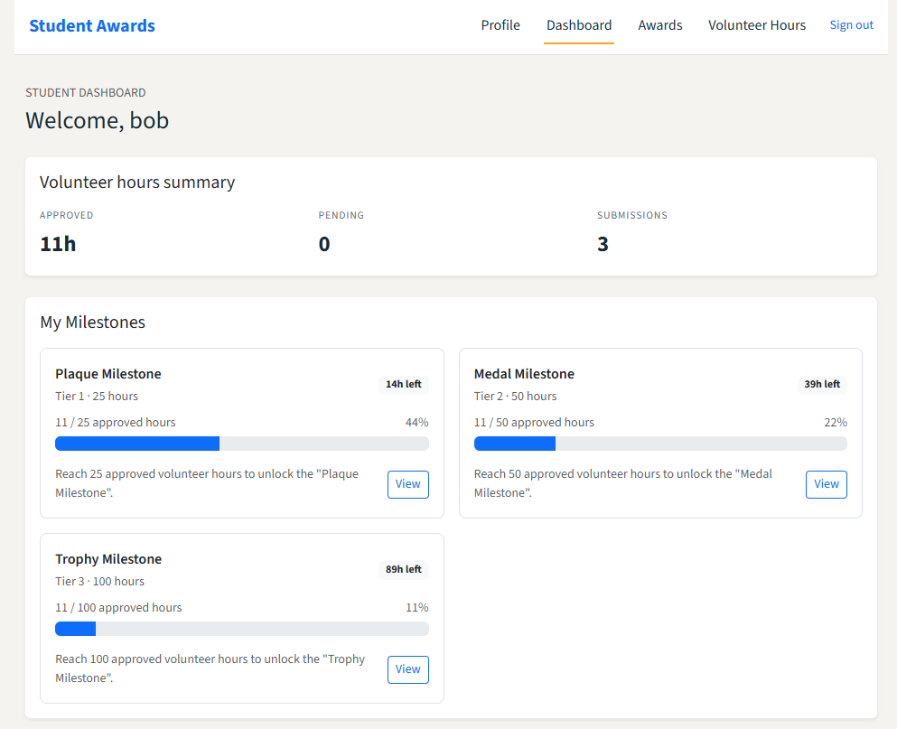

**Figure 11.** UAT04 — Student dashboard showing approved-hour progress.

<!-- pdf-page-break -->

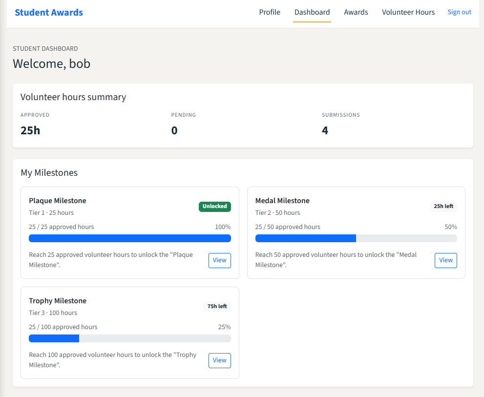

**Figure 12.** UAT05 — Dashboard showing the Plaque milestone unlocked.

<!-- pdf-page-break -->

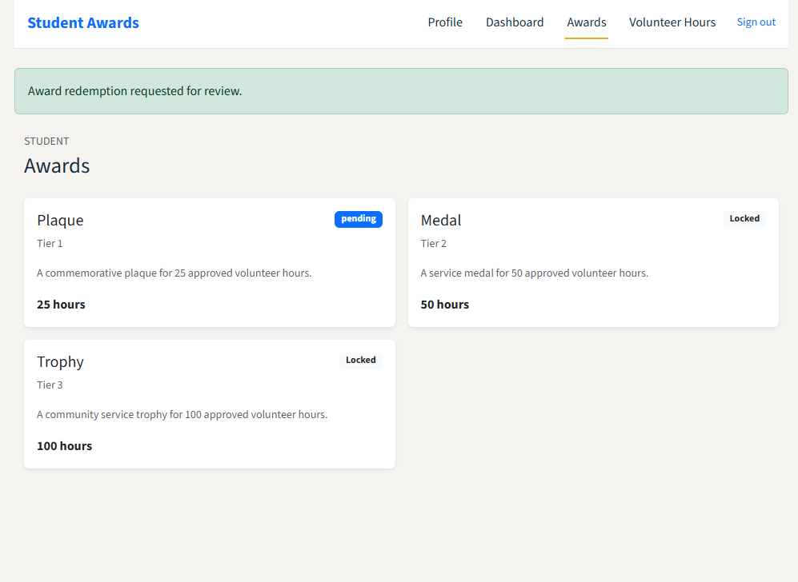

**Figure 13.** UAT06 — Award redemption request shown as pending.

<!-- pdf-page-break -->

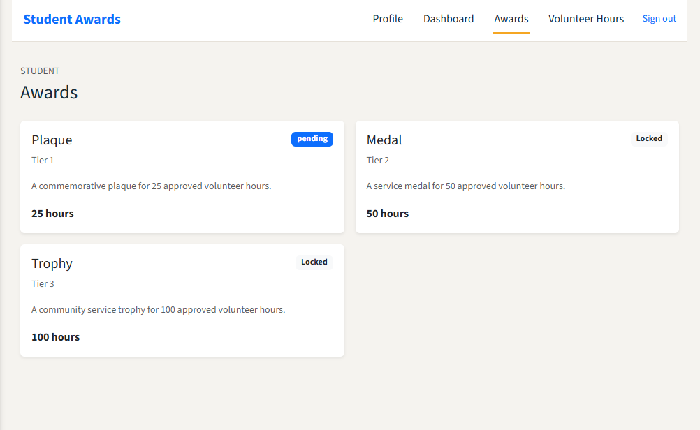

**Figure 14.** UAT07 — Existing pending redemption displayed with no second redemption action.

<!-- pdf-page-break -->

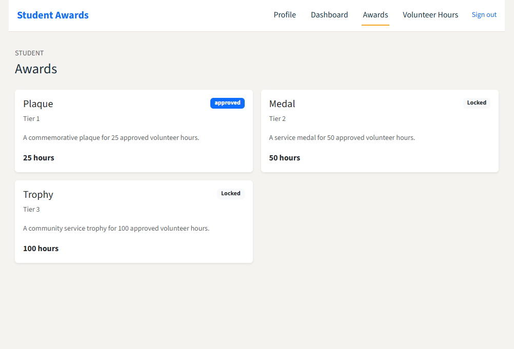

**Figure 15.** UAT08 — Administrator-approved award redemption status.

<!-- pdf-page-break -->

## F. Conclusion and limitations

The supplied test evidence reports **8/8 unit tests passed**, **7/7 integration tests passed**, **21/21 Postman assertions passed across 10 requests**, and **8/8 UAT cases passed**. The unit tests isolate service logic with mocks, while the integration tests use an in-memory SQLite database to exercise application components together. The Postman collection checks health, page responses, unauthenticated access, and an invalid milestone ID. The UAT plan and screenshots document the principal student and administrator workflows.

The results establish only the behaviors covered by these test cases and supplied evidence. The Postman collection is GET-only and does not exercise write endpoints or authenticated positive API workflows. The unit and integration test results do not replace browser acceptance testing, and this report does not claim that every route or edge case has been verified.

The updated UAT01 screenshot shows a **6-hour** Community Cleanup submission pending review, and UAT02 shows a **6-hour** Community Cleanup submission approved. The matching activity name and hour value are consistent with the review flow, although neither screenshot displays a submission ID to prove that they depict the same record. The UAT04 dashboard is an earlier progress snapshot at **11 approved hours**. After additional approved hours, the UAT05 screenshot shows **25 approved hours** and the Plaque milestone unlocked.

The integration-test screenshot contains one SQLite adapter deprecation warning. The recorded test run still passed; the warning is not evidence that the affected behavior failed, but it may merit attention in a future maintenance task.

<!-- pdf-page-break -->

## Appendix A. Test artifact locations

- Unit Test Plan: [`unit-test-plan.md`](unit-test-plan.md)
- Integration Test Plan: [`integration-test-plan.md`](integration-test-plan.md)
- User Acceptance Test Plan and completed results: [`uat-plan.md`](uat-plan.md)
- Unit tests: [`tests/test_volunteer_service_unit.py`](../../tests/test_volunteer_service_unit.py)
- Integration tests: [`tests/test_student_awards_flow.py`](../../tests/test_student_awards_flow.py)
- Postman collection: [`COMP3613 Assignment 2 - Student Awards API Tests.postman_collection.json`](../../COMP3613%20Assignment%202%20-%20Student%20Awards%20API%20Tests.postman_collection.json)
