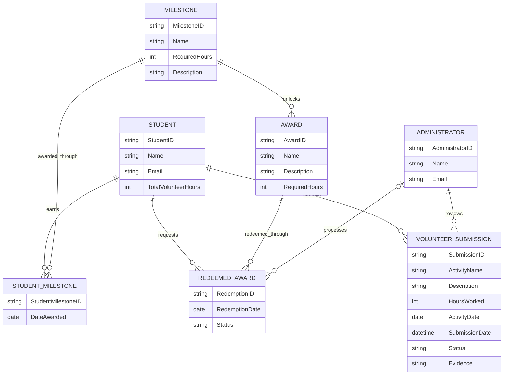

# COMP 3613 Assignment 1

Draft this file with the Guide. **Update it after every phase milestone** before you pause. The use-case diagram is a UML PNG at `docs/diagrams/use-case.png`, linked from this file as `diagrams/use-case.png` (path relative to `docs/report.md`). The model diagram is Mermaid. **Embed wireframe images** as `wireframes/<file>` (files live in `docs/wireframes/`).

Do not put your student ID in this file if you will commit it. The PDF cover adds your name and ID at export time.

## Assigned project
Student Awards (incentive system)

## Three workflows

### 1. Verify Volunteer Hours (Student and Administrator)

### 2. Track Progress and Unlock Milestones (Student)

### 3. Redeem an Award (Student)

## Use case diagram

Verify Volunteer Hours is shared: the Student submits volunteer activity and hours, and the Administrator reviews and approves or rejects the submission. View Submission Evidence «extends» Verify Volunteer Hours as a conditional supporting action. Track Progress and Unlock Milestones and Redeem an Award are Student use cases. View Milestone Details «extends» Track Progress and Unlock Milestones as a conditional supporting action. Hour submission remains within Verify Volunteer Hours.

## Model diagram

First draft based on the student's entities, relationships, and business rules. Update this section in Phase 5 when polish revises the model, and note what changed.

### Relationships and rules

- A Student submits many VolunteerSubmissions; each submission belongs to one Student and is reviewed by one Administrator.
- Student and Milestone have a many-to-many relationship resolved through StudentMilestone.
- Student and Award have a many-to-many relationship resolved through RedeemedAward.
- An Administrator can process many RedeemedAwards; each redemption is processed by zero or one Administrator.
- A Milestone unlocks many Awards; each Award is associated with one Milestone.
- VolunteerSubmission and RedeemedAward statuses are Pending, Approved, or Rejected. Existing redemption rows marked Processing remain supported as pending review.
- Only approved volunteer hours contribute to milestone progress and award eligibility.
- A Student cannot redeem the same Award more than once and can redeem it only after the required milestone is unlocked.
- A rejected submission does not add hours to approved student hours and therefore does not contribute to milestones or awards. A rejected redemption does not grant the award.

## Wireframes

### Student Award Wireframes

Phase 4 review: the wireframe set is usable and clearly supports the three workflows: verifying volunteer hours, tracking milestone progress, and redeeming an award. It aligns with the model by showing the Student, Administrator, Volunteer Submission, Milestone, and Award relationships. The main metadata to confirm before implementation is the exact path from a submitted volunteer activity to approval/rejection, and how the student reaches the redemption screen from the milestone/progress view.

If those transitions are not obvious in the design, the student should clarify the screen flow before implementation begins. No major redesign is needed yet, but the completion path for each named workflow should be explicit.

## Theming

The Student Awards wordmark uses Fraunces for display headings and Source Sans 3 for body text. The theme combines a deep charcoal/navy background with warm saffron and teal accents, pale surfaces, and a clear, encouraging service-recognition tone. Shared CSS tokens apply the branding across the landing, login, and register pages.

## Implementation notes

All three named workflows are implemented with thin routes calling the volunteer service, which coordinates repository operations:

- Verify Volunteer Hours: students submit dated activities with descriptions and evidence; administrators approve or reject them.
- Track Progress and Unlock Milestones: approved submission hours determine totals and earned 25-, 50-, and 100-hour milestones.
- Redeem an Award: eligible students request the tier award; administrators review pending requests. Rejected requests do not grant the award.

The student shell now has top navigation for Profile, Dashboard, Awards, and Volunteer Hours. Student profile, award catalog, volunteer submission/history, and milestone detail are separate pages. The dashboard shows each award milestone's tier, approved-hour progress, and remaining hours.

Student volunteer submissions record an activity date separately from their submission timestamp. The database seed backfills activity dates for existing rows. The administrator dashboard links to a pending-only review queue, while the Volunteer Hours navigation shows submissions in every status. Each row's Review/View link opens a detail page with the student name, activity date, hours, submission timestamp, student-written activity description, evidence, and Approve/Reject/Exit Review actions.

The Awards page shows Locked/Unlocked eligibility. Redeeming an eligible award opens a confirmation page with its tier, required hours, status, description, and a one-time redemption notice. A student cannot request the same award again, including after rejection. Seeded reviewer rationales are stored separately from student-written activity descriptions.

The seed creates eleven students, two administrators, 30 dated volunteer submissions, the 25/50/100-hour tiers and Plaque/Medal/Trophy awards, earned StudentMilestone records, and six redemption examples. Ten seeded student usernames match their full names and use `studentpass`; a separate Bob account uses `bob` / `bobpass`. The name-based profile emails use `firstname.lastname@gmail.com`, and the separate Bob profile uses `bob@gmail.com`. The seed migration updates existing student accounts by email without changing their user IDs.

**Verification:** the student previously reported that the workflows work locally and continued steering UI polish. The focused workflow, seed migration, schema, and distinct user/student ID tests pass (7 passed); no separate browser walkthrough of the latest pages was recorded.

**Phase 5 status:** complete for now at the student's request. Implementation, theming, and requested polish are recorded above. Phase 6 deployment remains outstanding.

## Deployed app

Phase 6. Public Render URL (not localhost). Markers open this to mark the three workflows.

https://

## Logins

Every account a marker needs, including extra users you added. Starter accounts:

- bob / bobpass — regular user
- Bruce Wayne, Vert Wheeler, Kyryll Flins, Fang Runin, Percy Jackson, Evie Sage, Jake Peralta, Mitchell Pritchett, Rick Sanchez, and John Stewart / studentpass — regular users (each full name is the username)
- admin / adminpass — admin
- admin2 / adminpass — admin

## YouTube URL

## Session transcripts

Filled when the Guide builds the report: the agent writes each Guide chat to `docs/transcripts/<slug>.md` (Copilot Agent, Cursor, or OpenCode). `python manage.py report` packages them. Do not paste chats here during the build.

## Competency (student-judge)

Filled when the report is built. Guide runs student-judge, writes `docs/judge.md`, and export appends the scorecard here.

## Skill integrity

Filled by `python manage.py report`. Do not edit the course skills.
