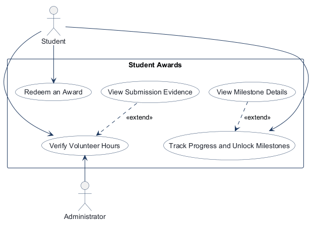
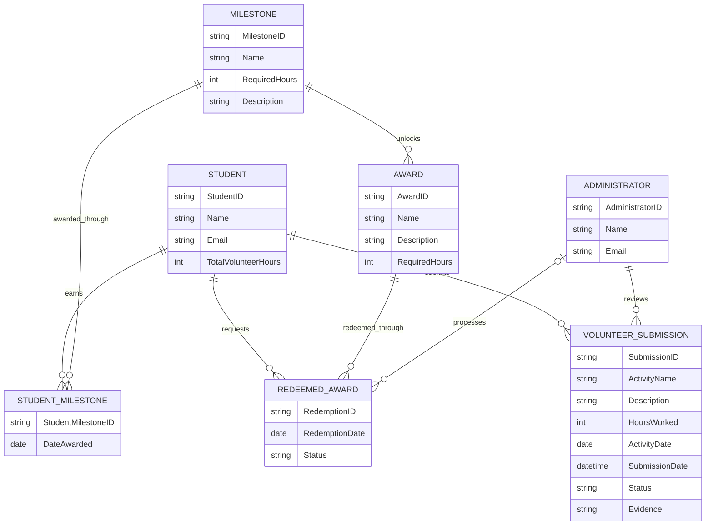
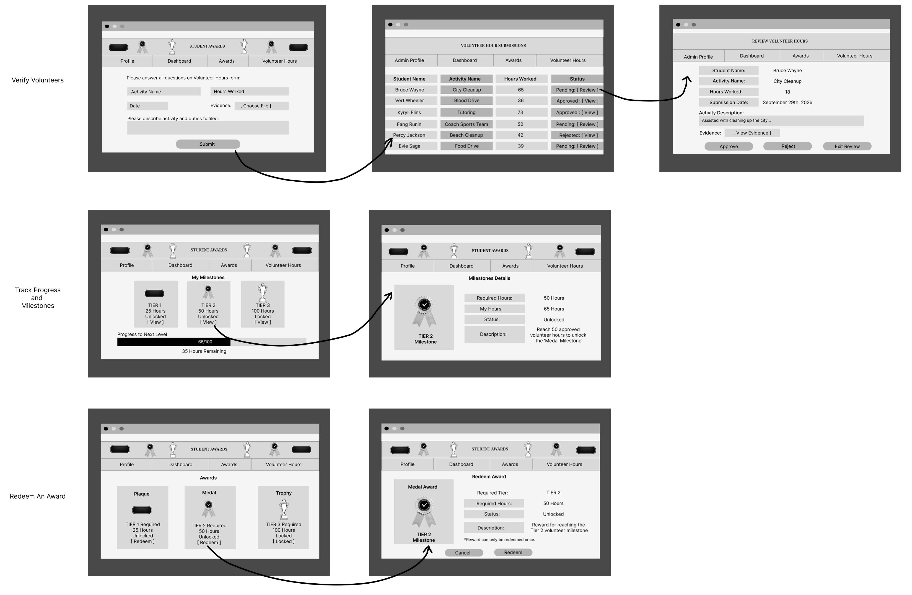

<!-- student-build:skill-integrity
status: pass
root: e84cd692d0b85eefe546385661958c27d07e8be6c5176a82012f68ccff5c8beb
expected_root: e84cd692d0b85eefe546385661958c27d07e8be6c5176a82012f68ccff5c8beb
mismatches: none
-->

# COMP 3613 Assignment 1

Student Name: Edan Ali

Agent used: GitHub Copilot Agent

GitHub Repository: https://github.com/al5428/comp3613a1

Draft this file with the Guide. **Update it after every phase milestone** before you pause. The use-case diagram is a UML PNG at `docs/diagrams/use-case.png`, linked from this file as `diagrams/use-case.png` (path relative to `docs/report.md`). The model diagram is Mermaid. **Embed wireframe images** as `wireframes/<file>` (files live in `docs/wireframes/`).

Do not put your student ID in this file if you will commit it. The PDF cover adds your name and ID at export time.

## Assigned project
Student Awards (incentive system)

## Three workflows

### 1. Verify Volunteer Hours (Student and Administrator)
Actors: Student and Administrator

Description: Students submit volunteer activities for verification, and administrators review the submitted information and evidence.

Steps:
1. The student logs in and navigates to the Volunteer Hours page.

2. The student enters the activity name, hours worked, activity date, description, and supporting evidence.

3. The system saves the submission with a Pending status.

4. The administrator opens the Volunteer Hours review queue and selects a pending submission.

5. The administrator reviews the activity details and supporting evidence.

6. The administrator approves or rejects the submission.

Completion: The submission is marked Approved or Rejected. Only approved volunteer hours contribute to the student's total hours.

### 2. Track Progress and Unlock Milestones (Student)
Actor: Student

Description: Students track their approved volunteer hours and progress towards earning awards.

Steps:
1. The student logs in and opens the Dashboard.

2. The system displays the student's total approved volunteer hours.

3. The student views their progress towards the three milestones:
Tier 1: Plaque — 25 hours.
Tier 2: Medal — 50 hours.
Tier 3: Trophy — 100 hours.

4. The student can open the Milestone Details page to view the requirements and progress for each milestone.

5. The system unlocks milestones when the student reaches the required number of approved hours.

Completion: The student's progress is displayed, and milestones become unlocked once the required approved volunteer hours are achieved.

### 3. Redeem an Award (Student)
Actors: Student and Administrator

Description: Students who have unlocked the required milestone can request an award, which an administrator reviews.

Steps:
1. The student logs in and navigates to the Awards page.

2. The system displays available awards and indicates whether each is Locked or Unlocked.

3. The student selects an eligible award and opens the redemption confirmation page.

4. The student confirms the redemption request.

5. The system creates a Pending redemption request.

6. The administrator reviews the request and approves or rejects it.

Completion: The redemption request is marked Approved or Rejected. The system prevents students from submitting duplicate requests for the same award, even if a previous request was rejected.

## Use case diagram

Verify Volunteer Hours is shared: the Student submits volunteer activity and hours, and the Administrator reviews and approves or rejects the submission. View Submission Evidence «extends» Verify Volunteer Hours as a conditional supporting action. Track Progress and Unlock Milestones and Redeem an Award are Student use cases. View Milestone Details «extends» Track Progress and Unlock Milestones as a conditional supporting action. Hour submission remains within Verify Volunteer Hours.

## Model diagram

### Relationships and rules

- A Student submits many VolunteerSubmissions; each submission belongs to one Student and is reviewed by one Administrator.
- Student and Milestone have a many-to-many relationship resolved through StudentMilestone.
- Student and Award have a many-to-many relationship resolved through RedeemedAward.
- An Administrator can process many RedeemedAwards; each redemption is processed by zero or one Administrator.
- A Milestone unlocks many Awards; each Award is associated with one Milestone.
- VolunteerSubmission and RedeemedAward statuses are Pending, Approved, or Rejected. Existing redemption rows marked Processing remain supported as pending review.
- Only approved volunteer hours contribute to milestone progress and award eligibility.
- A Student cannot redeem the same Award more than once and can redeem it only after the required milestone is unlocked.
- A rejected submission does not add hours to approved student hours and therefore does not contribute to milestones or awards. A rejected redemption does not grant the award.

## Wireframes

### Student Award Wireframes

Phase 4 review: the wireframe set is usable and clearly supports the three workflows: verifying volunteer hours, tracking milestone progress, and redeeming an award. It aligns with the model by showing the Student, Administrator, Volunteer Submission, Milestone, and Award relationships. The main metadata to confirm before implementation is the exact path from a submitted volunteer activity to approval/rejection, and how the student reaches the redemption screen from the milestone/progress view.

If those transitions are not obvious in the design, the student should clarify the screen flow before implementation begins. No major redesign is needed yet, but the completion path for each named workflow should be explicit.

### Student Award Wireframes

## Theming

The Student Awards wordmark uses Fraunces for display headings and Source Sans 3 for body text. The theme combines a deep charcoal/navy background with warm saffron and teal accents, pale surfaces, and a clear, encouraging service-recognition tone. Shared CSS tokens apply the branding across the landing, login, and register pages.

## Implementation notes

All three named workflows are implemented with thin routes calling the volunteer service, which coordinates repository operations:

- Verify Volunteer Hours: students submit dated activities with descriptions and evidence; administrators approve or reject them.
- Track Progress and Unlock Milestones: approved submission hours determine totals and earned 25-, 50-, and 100-hour milestones.
- Redeem an Award: eligible students request the tier award; administrators review pending requests. Rejected requests do not grant the award.

The student shell now has top navigation for Profile, Dashboard, Awards, and Volunteer Hours. Student profile, award catalog, volunteer submission/history, and milestone detail are separate pages. The dashboard shows each award milestone's tier, approved-hour progress, and remaining hours.

Student volunteer submissions record an activity date separately from their submission timestamp. The database seed backfills activity dates for existing rows. The administrator dashboard links to a pending-only review queue, while the Volunteer Hours navigation shows submissions in every status. Each row's Review/View link opens a detail page with the student name, activity date, hours, submission timestamp, student-written activity description, evidence, and Approve/Reject/Exit Review actions.

The Awards page shows Locked/Unlocked eligibility. Redeeming an eligible award opens a confirmation page with its tier, required hours, status, description, and a one-time redemption notice. A student cannot request the same award again, including after rejection. Seeded reviewer rationales are stored separately from student-written activity descriptions.

The seed creates eleven students, two administrators, 30 dated volunteer submissions, the 25/50/100-hour tiers and Plaque/Medal/Trophy awards, earned StudentMilestone records, and six redemption examples. Ten seeded student usernames match their full names and use `studentpass`; a separate Bob account uses `bob` / `bobpass`. The name-based profile emails use `firstname.lastname@gmail.com`, and the separate Bob profile uses `bob@gmail.com`. The seed migration updates existing student accounts by email without changing their user IDs.

**Verification:** the student previously reported that the workflows work locally and continued steering UI polish. The focused workflow, seed migration, schema, and distinct user/student ID tests pass (7 passed); no separate browser walkthrough of the latest pages was recorded.

**Phase 5 status:** complete for now at the student's request. Implementation, theming, and requested polish are recorded above.

**Phase 6 status:** the Render web service is deployed at the URL below, and the student later reported that the site was working without further issues after the administrator-ID fix. The final `GET /health` result was not recorded in the Guide chat.

## Deployed app

Phase 6. Public Render URL (not localhost). Markers open this to mark the three workflows.

https://faststarter-r5s6.onrender.com/

## Logins

These are the seeded database accounts and their credentials for the app:

- bob / bobpass — student
- Bruce Wayne / studentpass — student
- Vert Wheeler / studentpass — student
- Kyryll Flins / studentpass — student
- Fang Runin / studentpass — student
- Percy Jackson / studentpass — student
- Evie Sage / studentpass — student
- Mitchell Pritchett / studentpass — student
- Rick Sanchez / studentpass — student
- John Stewart / studentpass — student
- admin / adminpass — administrator
- admin2 / adminpass — administrator

## YouTube URL

https://youtu.be/0mcZG_XwawA

## Session transcripts

Filled when the Guide builds the report: the agent writes chat markdown into `docs/transcripts/`; `python manage.py report` packages them.

Guide packaged **4** chat(s) in `docs/transcripts/` (and `docs/transcripts.zip`).

Index: [docs/transcripts/INDEX.md](transcripts/INDEX.md)

- [`phase1-3-2026-09-28`](transcripts/phase1-3-2026-09-28.md)
- [`phase4-initial-phase5-2026-10-01`](transcripts/phase4-initial-phase5-2026-10-01.md)
- [`phase5-polish-2026-10-05`](transcripts/phase5-polish-2026-10-05.md)
- [`phase6-render-2026-10-05`](transcripts/phase6-render-2026-10-05.md)

## Competency (student-judge)

Filled by Guide from the student-judge run when this report was built.

**Judged at:** 2026-10-09
**Evidence pass:** fresh read of four local Copilot session-index conversations, current `docs/report.md`, `docs/diagrams/`, `docs/wireframes/`, current app routes, and skill-integrity check; prior `docs/judge.md` ignored
**Student / session:** Edan Ali (GitHub Copilot Agent)
**Artifact:** Guide-chat excerpts collected from local Copilot session index into `docs/transcripts/*.md`, plus current project artifacts
**Phases in evidence:** 1–6 (COMP 3613; Phase 5 polish, Phase 6 deploy; never generic 0–5)

### Totals
| | Count / value |
|--|--|
| Metrics on rubric | 12 (M1–M12) |
| N/A (excluded) | 0 |
| Metrics scored | 12 |
| Scoreable max | 48 |
| Awarded total | 42 / 48 |
| **Overall (avg of scored)** | **3.5 / 4** |
| Impression mark | 18 / 20 |

## Scorecard

| ID | Metric | Score / 4 | In avg | Evidence |
|----|--------|----------:|:------:|----------|
| M1 | Phase discipline | 3 | yes | Student started the project phases in sequence, then explicitly said “before we complete phase 5” and requested Phase 6 after extended polish. Minor process looseness: the student initially said “everything works” before detailed UI and account polish continued. |
| M2 | Problem framing | 4 | yes | The student selected Student Awards, named three `Feature (user)` workflows, clarified student/admin participation, requested the two extend relationships, supplied entity properties/cardinalities, and stated approval/rejection business rules. |
| M3 | Decision ownership | 4 | yes | The student made concrete design choices, including “The four links should be Profile, Dashboard, Awards and Volunteer Hours,” the all-status versus pending-only admin views, and the distinct Bob account with its own credentials. |
| M4 | Artefact-before-code | 4 | yes | The Phase 2 use-case artifact and Phase 3 ERD were present before implementation; the student restored and embedded their own wireframe, then repeatedly used that wireframe to request targeted changes. |
| M5 | Verification habit | 2 | yes | Student reported “everything works” and later surfaced observed issues (“I am still not seeing it appear on a new page” and “Why does the pending look like this?”), and reported Render working after fixes. However, detailed local per-workflow comparisons and a final health check were not recorded; most explicit test evidence is agent-run. |
| M6 | Assignment fit | 3 | yes | The student stayed within the named workflows, reused FastStarter, and steered layered service-backed behavior. A shipped unused `/app/volunteer-hours` POST handler still raises `NotImplementedError`, so the current app has a leftover incomplete route despite the linked form using `/app/submissions`. |
| M7 | Slice explanation | 2 | yes | Student attempted model and route snippets after prompts. The relationship snippet required mapper-annotation repair; route snippets had indentation or incomplete-body issues, and repository/service snippets also needed indentation correction. Student did not explain those layer choices in their own words. No student route SQL was observed. |
| M8 | Prompt quality | 4 | yes | Prompts were specific and increasingly tied to observed mismatches, e.g. the four-link header, four-column status table, review detail fields/actions, and one-time award redemption page. |
| M9 | Response to pushback | 4 | yes | The student repeatedly corrected incomplete work with concrete evidence and continued polishing rather than accepting the first build: “there is still a 5th column,” “I am still not seeing it appear on a new page,” and a screenshot-backed Pending badge correction. |
| M10 | Integrity | 4 | yes | `python manage.py skills-verify` passed; no protected course-file changes or laundering indicators were found in the available turns. |
| M11 | Provenance continuity | 4 | yes | Phase 5 decisions consistently trace back to the Student Awards workflows, ERD, wireframe, seeded tiers, and student-provided review/redeem screens. The deployment chat uses the student's `al5428/comp3613a1` repository and `main` branch. |
| M12 | Sincerity trajectory | 4 | yes | No sincerity blocks or suspicion rounds were found. The student remained engaged across design, implementation, polish, and deployment troubleshooting. |

## Strengths
- Student owned the project, named workflows, actors, entities, relationship cardinalities, business rules, and multiple workflow decisions.
- Supplied and restored the required wireframe, then used it repeatedly to steer specific UI changes instead of treating the first build as final.
- Identified real runtime/data issues, including administrator foreign-key mapping during Render review and Bob's User/Student ID mismatch.
- Kept the feature work traceable to the existing ERD and FastStarter service/repository architecture; no persistence-in-router snippet was found.
- Phase 6 deployment evidence includes a public Render URL, selected workspace/repository, a reported admin-review fix, and the student's statement that the site appeared to work afterward.

## Gaps (priority order)
1. A residual `NotImplementedError` remains in `submit_volunteer_hours` in `app/routers/user_home.py`. The visible student form posts to `create_volunteer_submission`, so this may be an unused legacy route, but it should be removed or completed before treating every route as finished.
2. Local verification notes are thin. The student reported broad success and identified visible mismatches, but did not record a concrete final local walkthrough against the finished forms/pages; the deployment chat also does not record a final `GET /health` result after the database configuration issue.
3. Several assigned code snippets required agent repair for indentation or SQLModel relationship resolution. The student attempted the snippets, so this is a learning opportunity rather than refusal; add a short own-words explanation of the corrected Student/User ID mapping and route-to-service path.

## Phase gate status
| Phase | Status | Note |
|-------|--------|------|
| 1 | met | Student selected Student Awards and named three workflows in the requested format. |
| 2 | met | Student answered include/extend and actor questions, reconsidered submission ownership, and requested the two supporting extend use cases; UML PNG was generated. |
| 3 | met | Student named entities/properties, specified cardinalities and bridge relationships, and stated status/eligibility/rejection rules. |
| 4 | met | Student supplied a wireframe, had it embedded, and used it as the implementation reference. |
| 5 | met | Theme/build were followed by substantial student-led polish across navigation, milestone details, volunteer review, award redemption, seed accounts, and profile data. Residual route stub and limited final local notes are noted above. |
| 6 | met | Render Postgres and web service were reported created; URL and marker logins are in the report. Student reported the site worked after the admin-ID fix; a final health-check result is not in the recorded chat. |

## Recommended next practice
- Resolve or delete the unused `submit_volunteer_hours` stub, then run one local student submission and one admin approve/reject flow and write down the observed outcome for each.

## Integrity note
- Clean. Protected-skill verification passed; no laundering flags were found in the accessible student turns.

## Provenance flags
- None. The four project chats form a coherent progression from Phase 1 decisions through wireframe-driven polish and Render deployment.

## Sincerity log summary
- Blocks found: 0 | max round: N/A | min/mean/final confidence: N/A | trend: N/A | cleared: not needed

## Skips
- Skips: 0/3 used (from available Guide evidence).

## Evidence limitations
- The local session index retained four project chats and their student messages, but several assistant responses were truncated; the debug-log files retained session-start metadata only. The files under `docs/transcripts/` are Guide-collected excerpts/summaries, not raw native transcript exports. Scoring is based on the available turn excerpts, live current chat, current artifacts, and report; no Cursor `.jsonl` was required.

## Skill integrity

Course skills are hashed at export and compared to `.agents/skills.lock.json`. Do not edit `.agents/skills/`, `.cursor/skills/`, or `AGENTS.md`.

- Status: **pass**
- Root: `e84cd692d0b85eefe546385661958c27d07e8be6c5176a82012f68ccff5c8beb`
- none
